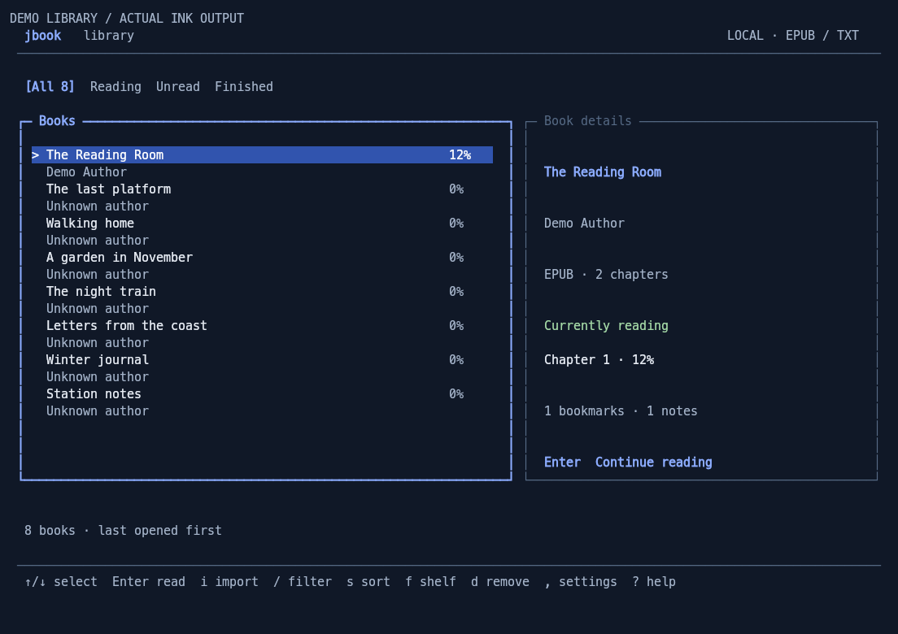

# joobook

Read local EPUB and TXT books in a terminal. joobook remembers your position and
saves bookmarks and passage notes. It uses TypeScript, React, and Ink.



## Install

Requires Node.js 22 or newer.

```sh
npm install -g joobook
joobook
```

Open a book directly:

```sh
joobook ~/Books/book.epub
```

## Library and reading

The library starts empty. Press `i` to browse local folders. Select files with
`Space`, then press `Enter` to import them. Press `p` to type a file or folder
path. Multiple command-line file arguments import those files and open the
first book. Importing an identical file keeps its existing notes and position.

Use `↑` and `↓` to select a book, then `Enter` to read. While reading,
use `←` and `→`, or page keys, to turn pages. `↑` and `↓` scroll by one line.
`Space` advances a page. `Esc` returns to
the library. `q` in the library or `Ctrl+C` saves the reading position and quits.

| Key | Action |
| --- | --- |
| `t` | Open the table of contents |
| `[` / `]` | Previous / next chapter |
| `g` | Jump to `50%`, a percentage, or `ch 7` |
| `/` | Search the whole book; filter title or author in the library |
| `f` | Toggle focus reading; change shelf in the library |
| `b` / `m` | Add a bookmark / list bookmarks |
| `v` | Select a passage with arrows, then `n` to add a note |
| `y` | Copy the selected passage to the system clipboard |
| `a` | List notes; `e` edits the selected note |
| `Ctrl+S` | Save a note or preferences |
| `x` | Export notes and bookmarks from either list |
| `,` | Open preferences |
| `?` | Open the complete keyboard reference |
| `!` | Expand the current error into a scrollable view |

Saving a selected passage with an empty note creates a highlight. `Enter` in
the notes or bookmarks list returns to its saved position. `d` opens a deletion
confirmation, with Keep selected initially. Removal never deletes the source
book file.

Preferences control theme, text width, line spacing, last-book resume, and
optional Vim shortcuts. Arrow keys are the default. Use `↑` and `↓` to select a
field and `←` and `→` to change it. Changes preview immediately. `Ctrl+S` keeps
them and `Esc` cancels. A terminal needs at least
36 columns and 18 rows. Narrow terminals show one full-width view at a time.

## Files and saved data

Original files stay in their source folders. Moving a file opens a recovery
screen where `l` locates its new path. Relinking requires an identical file so
that existing passage positions stay valid. Import an edited book or another
edition as a separate book.

The library, preferences, bookmarks, and notes are stored in
`$XDG_DATA_HOME/joobook/library.json`, or `~/.local/share/joobook/library.json` when
`XDG_DATA_HOME` is unset. Use `--home PATH` for a separate library. Exports are
UTF-8 text files under that library's `exports/` folder. Back up the library
folder together with the original book files.

Writes replace the state file atomically. One writer can open a given library
at a time. A corrupted library produces an error and is left in place.

## Options

```text
joobook [options] [book.epub | book.txt ...]

--home PATH       Use a different library directory
--theme NAME      system, dark, or light; override the saved preference
--library         Start at the library instead of resuming
--list            Print the saved library as JSON without opening the TUI
--no-alt-screen   Keep output in the terminal's normal screen
--help, -h        Show usage
--version, -v     Show version
```

System theme inherits your terminal profile's background, foreground, and ANSI
palette, including custom profiles such as Ocean. Selected rows invert the
terminal's text and background colors. No environment-based light/dark guess
is needed. Dark and Light use joobook's fixed palettes when selected explicitly.

## Supported content

EPUB 2 and 3 books are read in spine order. Chapter counters and chapter jumps
follow the book's EPUB 3 navigation or EPUB 2 NCX table of contents, including
chapters linked by anchors inside a file. Front matter and nested subsections
do not inflate the chapter count. One chapter can span several content files.
When a book has no identified chapters, joobook labels its content as sections.
TXT accepts UTF-8, or UTF-16 with a byte-order
mark. Multiple `Chapter N` or Markdown headings divide TXT files into chapters.
Reading positions use source character offsets and survive terminal resizing.

EPUB tables preserve captions, headings, rows, and cells. They render as aligned
columns with wrapped cell text when space allows. Narrow or very wide tables
switch to labeled rows so every value remains readable. Merged column headings
and row groups retain their values. Use the usual arrow and page keys to read
through a table; search, bookmarks, and notes keep their original source anchors.
Nested table text remains inside its parent cell.

This is a text reader. It skips pictures, styles, audio, and scripts. It does
not support PDF, DRM-protected books, or image-only books. Files have a 64 MiB
import limit and EPUB text has a 128 MiB expanded limit. Search shows up to
1,000 matches. Clipboard copy uses `pbcopy` on macOS, `clip.exe` on Windows,
or `wl-copy`, `xclip`, or `xsel` on Linux. Notes export works without a clipboard.

## Development

From a local checkout:

```sh
npm install
npm run build
npm start
```

For development, use `npm run dev`. To make the local `joobook` command available
on your PATH, run `npm link` after building.

Run checks:

```sh
npm run check
npm test
```

The tests cover EPUB 2/3 parsing, Unicode wrapping and search, persistence,
duplicate detection, relinking, import, reading, notes, settings, removal,
and compact layouts. The original screen comps remain in `design/`.

To regenerate screenshots of actual terminal output with a temporary sample
library:

```sh
npm run screenshots
```

The TypeScript capture script renders the running Ink app in a virtual terminal
and writes PNG and text captures using Node.js. Screenshots use original
demonstration content and do not read your saved library. Pass a capture name
to regenerate one view, for example `npm run screenshots -- reader-wide`.
